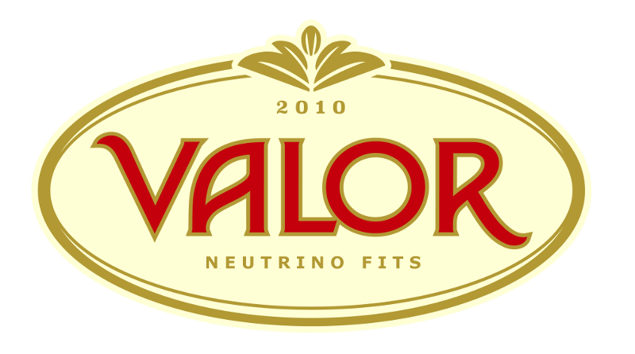

# The VALOR Software Development Kit (VALOR-SDK)

## Overview

The VALOR-SDK is a **highly abstracted**, experiment-agnostic neutrino oscillation analysis framework used across multiple experiments.

Experiment-specific VALOR analyses are built on top of the VALOR-SDK, primarily through XML configuration files. These define:
- **Event samples:** A list of samples to be included in the fit, each corresponding to a specific combination of beam configuration, detector, and observed topology.
- **Reconstructed kinematics:** The variables and binning scheme for each sample’s reconstructed distribution to be fit.
- **Contribution modes:** A list of **modes**—typically generator-level MC truth interaction channels—tracked separately for each fit distribution. A carefully chosen set of modes ensures proper application of systematic uncertainties and physics hypotheses.
- **MC-truth distributions:** For each mode in each sample, the MC-truth kinematic variables and binning are specified for every reconstructed bin. These enable systematics and physics hypotheses to be applied correctly. The combined multi-dimensional distribution, spanning both reconstructed and MC-truth variables for each mode in every sample, is referred to as an **MC template**.
- **Systematic parameters:**** The list of systematics to include in the fit.
- **Systematic priors and correlations:**** The prior uncertainties and input correlations between systematic parameters.
- **Systematic impacts:** A detailed specification of how each systematic parameter modifies kinematic bins in the MC templates for each mode and sample.
- **Physics hypotheses:** The chosen oscillation framework (e.g., three-flavour, 3+1 sterile, etc.), the parameters of interest, their fit ranges, and any external constraints.
 
For more information, see https://www.overleaf.com/read/ygmrxrjtmwyv

## Copyright 

Copyright (c) 2010-2025, The VALOR Group.

The VALOR SDK is made available under the **VALOR Restrictive Academic Research License**. 
The license provides limited rights. Please make sure you read the full text [here](LICENSE.md).

## Authors

* **Costas Andreopoulos**, *University of Liverpool*
* **Yaoqi Cao**, *University of Warwick*
* **Thomas Dealtry**, *Lancaster University*
* **Ziou He**, *University of Warwick*
* **Rhiannon Jones**, *University of Sheffield*
* **Komninos-John Plows**, *University of Liverpool*
* **Davide Sgalaberna**, *ETHZ*
* **Beth Slater**, *University of Liverpool*

Past authors:

* **Maria Antonova**, *IFIC Valencia*
* **Dom Barker**, *University of Sheffield*
* **Chistopher Barry**, *University of Liverpool*
* **Francis Bench**, *University of Liverpool*
* **Andrew Chappell**, *University of Warwick*
* **Steve Dennis**, *University of Warwick & STFC/RAL; University of Liverpool; University of Cambridge*
* **Lorena Escudero**, *University of Cambridge; IFIC Valencia*
* **Nick Grant**, *STFC/RAL; Lancaster University; University of Warwick*
* **Thomas Ham**, *University of Liverpool*
* **Tereza Kroupova**, *University of Pennsylvania*
* **Jaiden Parlone**, *University of Liverpool*
* **Raj Shah**, *University of Oxford & STFC/RAL*

## Contact

Professor **Costas Andreopoulos**  
**University of Liverpool**, Department of Physics  
*Oliver Lodge Lab 316, Liverpool L69 7ZE, UK*  
*E-Mail*: < c.andreopoulos \at cern.ch >  
*Tel*: +44-1517-943201 (office) | +44-7540-847333 (mobile)

